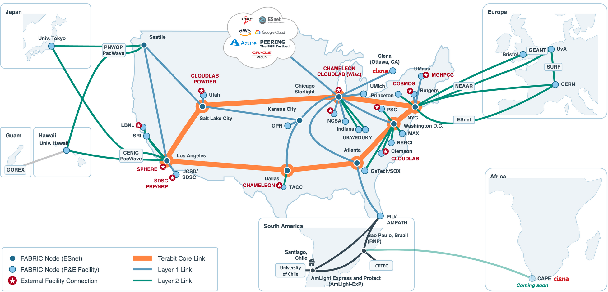

# CryoEM Without Borders — FABRIC weave

A demo of single-particle cryoEM pre-processing (frame alignment and CTF estimation) on a multi-GPU FABRIC node, followed by a **data transfer** of the results to a downstream site. The GPU node reads movies from the project's **cryoem-without-borders** storage volume (the storage behind the Globus collection). It then sends the processed results to a receiver node at **FIU**, which will later be replaced by **CAPE**, over a dedicated FABRIC link.

```
 Ceph volume (input, west cluster)
        │  FABNetv4 (CEPH_STORAGE)
        ▼
 ┌──────────────┐   XFER: dedicated L2 site-to-site link    ┌──────────────┐
 │ cryoem (GPU) │ ════════ 192.168.100.0/24, MTU 9000 ════► │ receiver FIU │  ~/cryoem-inbox
 │ MotionCor3   │        rsync over SSH, iperf3 baseline    │ (→ CAPE)     │  (local disk)
 │ CTFFIND4     │                                           └──────────────┘
 └──────────────┘
```

The transfer does not use the Ceph volume. Results go node to node over XFER and land on the receiver's local disk, so the demo shows a real wide-area data movement.



There are two phases:

| Phase | What | Where |
|---|---|---|
| A. Bring-up (automated) | Pick a GPU host, create the slice, mount the volume, install the tools, extend the lease, write `results/slice_info.json`, **exit** | `weave.sh` → `provision.py` |
| B. Experiment | MotionCor3 (all GPUs) → CTFFIND4 → before/after figures → whole-dataset run with timing comparison → transfer to FIU (iperf3 baseline, parallel rsync, checksum verify) → optional RELION 5 pipeline | `cryoem_experiment.ipynb` |

## Files

```
weave.json            LoomAI manifest (args below)
weave.sh              run script: bring-up only, exits when ready
weave_cleanup.sh      cleanup script: honors KEEP_SLICE (keeps the slice by default)
provision.py          start | status | extend | stop
fabric_env.py         token + project shared by provision.py and the notebook
tools/setup-node.sh   NVIDIA driver, CUDA 12.x, MotionCor3, CTFFIND 4.1.14, RELION 5.0, Python env
tools/cryoem_preview.py  on-node before/after figures + summary.json
tools/setup-receiver.sh  receiver: rsync, iperf3, ~/cryoem-inbox
tools/net-tune.sh     TCP buffers / BBR / fq + MTU on the XFER interface (both ends)
cryoem_experiment.ipynb  the demo
demo_viz.py           local demo charts: slice map, batch dashboard, transfer charts, stage timeline
figures/              FABRIC and AmLight network maps shown in notebook §2
```

## Credentials and project

`fabric_env.py` uses your **default FABRIC token** (the one `fabric_rc` / `FABRIC_TOKEN_LOCATION` points to, normally `~/work/fabric_config/id_token.json`) and passes the **CryoEM Without Borders** project (`c93be0c1-696c-4c36-9dbd-03b14be196af`) to `FablibManager`, so nothing has to be copied into this folder. The bastion user, bastion key and slice keys also come from `~/work/fabric_config/fabric_rc`. To use a different token file, set `CRYOEM_TOKEN=/path/to/token.json`.

The preflight check reads the project's permission tags from that same token. FABRIC tokens are short-lived; fablib refreshes the token automatically while its refresh token is valid. If calls fail with auth errors, or after a new tag is added to the project, download a fresh token from the Credential Manager.

## Storage volume

`cryoem-without-borders` is a CephFS subvolume on the **west** Ceph cluster:
`/volumes/c93be0c1-…/cryoem-without-borders/…`. `provision.py` calls `node.enable_storage(cluster="west")`. This adds a FABNetv4 link to Ceph, and fablib mounts every subvolume your account can access during post-boot. The CryoEM volume is used in place at **`/mnt/cephfs/west/<bastion user>/c93be0c1-…_cryoem-without-borders`**. The user part differs per account, so `fabric_env.data_dir(node)` finds the mount point on the node, and setup fails if it isn't mounted.

Upload data through Globus (collection `651ebde0-d63e-4f8d-843b-a457a1326112`) and it appears under that `/mnt` path. Outputs are written to the node's local disk (`~/cryoem-work/<run>`), and §9 transfers them to the receiver, not back to the volume.

## Args (weave.json)

| Arg | Default | Meaning |
|---|---|---|
| `SLICE_NAME` | `cryoem-demo` | Slice name; the notebook connects to it |
| `NUM_GPUS` | `2` | GPUs on the VM, all from one host |
| `GPU_MODEL` | `auto` | Best model with `NUM_GPUS` free (A40 > A30 > RTX6000 > T4), or a pinned model |
| `SITE` / `EXCLUDE_SITES` | blank | Pin or skip sites |
| `CORES` / `RAM` / `DISK` | 16 / 64 / 500 | VM size. FABRIC's largest VM disk is 1000 GB. §7b runs detached on the node in batches of `FULL_BATCH` movies, fits CTF per batch, deletes each aligned sum once fitted and streams each batch to the receiver (deleting it locally once verified there), so all 5,658 movies fit on 500 GB; it retries a failed batch once, stops with the reason if it fails again, and continues where it stopped when the cell is run again |
| `RECEIVER_SITE` | `FIU` | Downstream site that receives the results (blank = no receiver) |
| `RECEIVER_CORES` / `RAM` / `DISK` | 8 / 32 / 500 | Receiver VM size; cores for the parallel transfer. Whole-dataset results need ~380 GB |
| `XFER_SUBNET` | `192.168.100.0/24` | Private subnet of the dedicated transfer link |
| `XFER_NIC` | `NIC_Basic` | NIC on both ends of the transfer link: `NIC_Basic` (shared), `NIC_ConnectX_5` (2×25G), `NIC_ConnectX_6` (2×100G), `NIC_ConnectX_7_100`. ConnectX needs the matching project tag, e.g. `Component.SmartNIC_ConnectX_5` |
| `PIN_CPU` | `true` | Pins both VMs' vCPUs to the transfer NIC's NUMA node (CPU pinning only, no restart); `false` skips it |
| `CUDA_VERSION` | `12.4` | CUDA 12.x (MotionCor3 links `libnvToolsExt`) |
| `INSTALL_RELION` | `true` | Build RELION 5.0 (CUDA, no GUI) |
| `LEASE_DAYS` | `14` | Lease extended to this many days after bring-up |
| `KEEP_SLICE` | `true` | Stop and cleanup leave the slice running |

## Behavior

* **No polling after creation.** `submit(wait=True)` blocks once until StableOK. After setup, the script prints `READY` and exits. Status checks (`ACTION=status`) are one-shot.
* **Re-runnable.** If the slice already exists, the weave skips provisioning and only re-runs node setup. Setup is idempotent, so a failed install can be retried without a new slice.
* **NVIDIA driver.** If the driver cannot load without a reboot, the node is rebooted once, the CephFS volume is re-mounted, and setup continues.
* **Slice is kept.** With `KEEP_SLICE=true`, neither the Stop button nor `weave_cleanup.sh` deletes the slice. Delete it explicitly with `ACTION=stop ./weave.sh cryoem-demo`, `KEEP_SLICE=false ./weave_cleanup.sh cryoem-demo`, or the last notebook cell.

## Data transfer (FIU now, CAPE later)

* **Topology:** `provision.py` adds a `NIC_Basic` to both VMs and joins them with an L2 network named `XFER`. FABRIC builds it as an L2STS circuit between the GPU site and FIU. The GPU node is never placed at the receiver's site, so the transfer always crosses the wide area. IPs are assigned automatically from `XFER_SUBNET`.
* **NIC (`XFER_NIC`):** `NIC_Basic` is a shared virtual function. A ConnectX gives each VM a dedicated card (port 1 is used). Placement only picks hosts that have the NIC free, at both ends; FIU has ConnectX-5 cards but no ConnectX-6. The preflight check stops with a clear message if the project lacks the model's tag (`Component.SmartNIC_ConnectX_5`, `…_ConnectX_6`, …).
* **CPU pinning (`PIN_CPU`):** fablib's `pin_cpu` puts each VM's vCPUs on host cores of its transfer NIC's NUMA node, once per VM (a marker file prevents repeats on re-runs). Memory is not NUMA-tuned (`numa_tune`), so no VM restart is needed. This helps most with a dedicated ConnectX at tens of Gbit/s. On the GPU node it can place the vCPUs on a different NUMA node from the GPUs, so set `PIN_CPU=false` when GPU throughput matters more than the transfer.
* **Tuning:** `net-tune.sh` sets large TCP buffers, BBR and fq on both ends, and MTU 9000 on the XFER interface. If a jumbo-frame ping across the link fails, it falls back to MTU 1500.
* **Access:** the GPU node gets its own key (`~/.ssh/xfer_ed25519`), authorized on the receiver, plus an SSH alias `receiver`. The alias uses the receiver's XFER IP as `HostName` and the GPU node's XFER IP as `BindAddress`, so VM-to-VM SSH and rsync always run on the dataplane. The weave and notebook §9 both check `$SSH_CONNECTION` and fail if a session is on any other network. iperf3 is bound to the XFER address too.
* **Notebook §9:** prints path, RTT, MTU and NIC (read from the live slice), runs an iperf3 baseline (first 5 s of TCP ramp-up left out) and a write test of the receiver's disk (`RXDISK_GB`, O_DIRECT), builds a SHA-256 manifest, then sends the files as `XFER_STREAMS` parallel rsync streams (default 16, timed on the node) and runs `sha256sum -c` on the receiver. Results go to `results/<run>/transfer.json`. `XFER_METHOD = "rsyncd"` (default) starts a temporary rsync daemon on the receiver, bound to its XFER address and open only to the GPU node's XFER address, and sends over plain TCP. `"ssh"` uses rsync over SSH (AES-GCM), which an untrusted path such as CAPE over the internet needs. OpenSSH's fixed ~2 MiB channel window caps each SSH stream at window / RTT: one stream reached 0.54 of 11.72 Gbit/s, and 8 streams MICH → FIU reached 2.25 of 7.92 Gbit/s.
* **Switching to CAPE:** in the notebook, set `DEST_SSH` / `DEST_DIR` to the CAPE endpoint; the rest of §9 is unchanged. In the slice, either set `RECEIVER_SITE` to CAPE's FABRIC site (if it is one) or replace the receiver's interface on `XFER` with a CAPE facility port, which keeps the same dedicated L2 path.
* **Streaming during the whole-dataset run (§7b):** a shipper job on the GPU node sends each finished batch (~6.5 GB) to `~/cryoem-inbox/full-streamed` on the receiver with rsync over SSH on the XFER link, verifies it there with `sha256sum -c`, and frees the GPU node's disk, while MotionCor3 processes the next batch (~7 min). Only the last batch is still in flight when processing ends. Failed sends are retried with back-off and never stop the processing.
* **Existing slices:** re-running the weave on a slice that predates the receiver adds the receiver node and the XFER link in place. The slice is modified, not recreated.

## Usage

```bash
python3 -m venv .venv && source .venv/bin/activate && pip install -r requirements.txt
./weave.sh cryoem-demo                    # bring-up (~30-60 min incl. builds)
ACTION=status ./weave.sh cryoem-demo      # one-shot check
ACTION=extend ./weave.sh cryoem-demo      # renew lease
# then open cryoem_experiment.ipynb (kernel: this .venv) and run top to bottom.
# The notebook finds the slice itself: $SLICE_NAME, else results/slice_info.json,
# else the only slice in the project with a 'cryoem' node.
```

## Demo visuals

| Where | Figure | What it shows |
|---|---|---|
| §2 | Footprint map (plotly; matplotlib fallback) | Every FABRIC site and inter-site link (hover for bandwidth), the AmLight network (spectrum, leased and partner links, traced from AmLight's map), this slice's nodes and XFER link on top, and **CAPE** (Cape Town; the future receiver) as a purple star with the planned path. Redrawn in §9 with the measured Gbit/s. The FABRIC network map and the AmLight maps are shown below it (`figures/`). |
| §7 | Per micrograph, 2×3 | Unaligned vs. aligned (binned), both power spectra, CTFFIND fit, drift track |
| §7 | Per micrograph, zoom | **Full-resolution crops** before/after, plus **signal vs. resolution**: power vs. resolution on the same scale for both, the 10–5 Å signal gain, and the CTF fit line |
| §7 | Batch dashboard | Drift per movie, high-resolution signal gain, CTF fit per micrograph, mean spectrum before/after, movies/min on the GPUs |
| §7b | Demo vs. whole dataset | MotionCor3 time measured vs. predicted from the demo, seconds per movie, CTF fit histogram for every movie (`results/full/scaling.png`, `scaling.json`) |
| §7b | Benchmark vs. workstation | Wall clock for motion correction + CTF on the whole dataset against the UCSC workstation (2× RTX 3090, 23 h 06 min), projected from seconds per movie while the run is going; time until every result is verified on the receiver; movies per hour per GPU (`results/full/benchmark.png`, `benchmark.json`) |
| §9 | Transfer | iperf3 per-second throughput vs. the achieved rsync rate, capacity vs. achieved bars, checksum badge |
| §9 | Timeline | Every stage from Ceph read to verified copy, colored by storage / GPU / CPU / network |

The "before" image is the same gain-corrected frames summed without alignment (MotionCor3 `-Align 0`). Both images therefore have the same dose and noise, and their power is directly comparable. All figures are saved under `results/<run>/`.

## Demo parameters

These defaults come from the demo instructions. Set them in notebook §1 to match the dataset:

* MotionCor3: `-Bft 150 -PixSize <Å/px> -OutStack 1 -Patch 1 1 -Trunc 1 -Gpu <all>`, in serial mode over the staged movies.
* CTFFIND4: voltage from the EPU metadata (200 kV for the Glacios data on the volume), Cs 2.7 mm, amplitude contrast 0.1, box 512, resolution 50–4 Å, defocus 5000–35000 Å in steps of 500, astigmatism restraint 100 Å, no exhaustive search, no phase shift.

The two examples in the instructions use different pixel sizes (3.49 and 1.326 Å). Notebook §3 prints the pixel size from the MRC header so you can set `PIXEL_SIZE` correctly.
